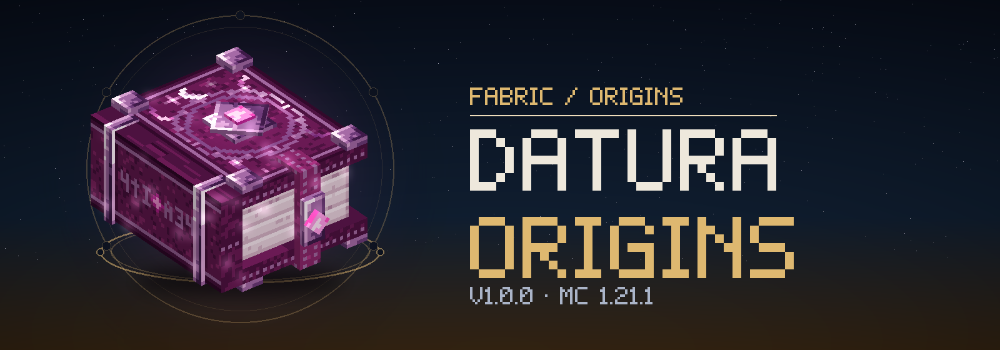
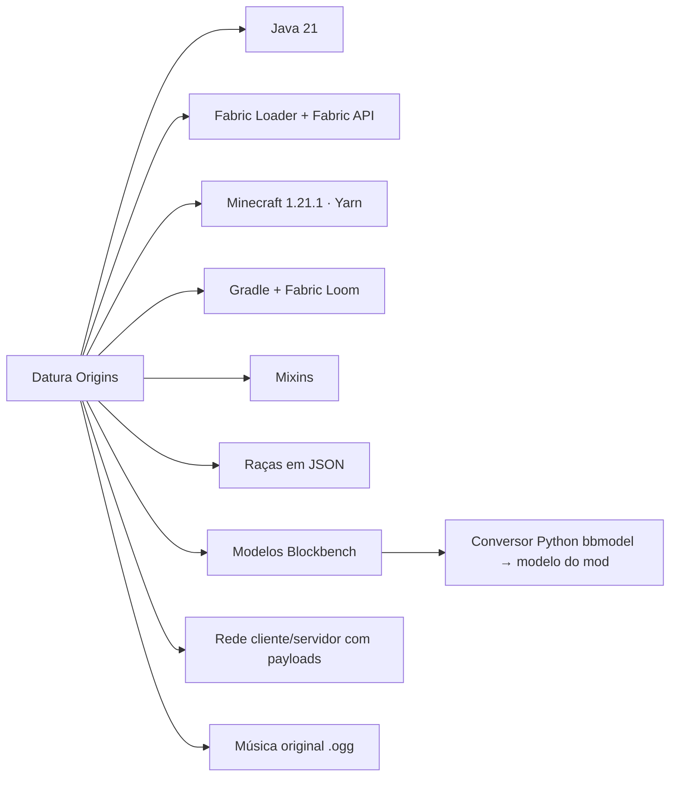

<b>Datura Origins v1.0.0</b> · Fabric · Minecraft 1.21.1

## Sobre

Datura Origins é um mod de raças para Minecraft. Ao entrar no mundo, você abre um grimório e escolhe sua origem. Cada raça tem um corpo próprio, vantagens, fraquezas e uma habilidade ativa. Nenhuma raça é perfeita: cada uma tem um ponto forte e uma fraqueza que o grupo ajuda a compensar.

> 📷 *Espaço para captura de tela: tela de introdução*

## Funcionalidades

- **Tela de seleção em forma de grimório**, com prévia 3D do personagem já usando a raça, lista de vantagens, desvantagens e habilidade.
- **Música ambiente original** na tela de seleção, que segue o volume de música do jogo.
- **24 raças**, algumas com variantes escolhidas na própria tela (ex.: Raposa Mística Fogo/Neve, Sereia Encantada/Profundezas/Grega).
- **Modelos 3D animados** feitos no Blockbench: caudas, asas, orelhas, chifres e chapéus que reagem a andar, nadar, voar, sentar e atacar.
- **Habilidade ativa** por raça, com recarga.
- **Formas do Nether**: Dríade, Espectro e Morto-Vivo perdem parte dos dons no Nether.
- **Maturidade**: Dragão, Morto-Vivo e Demônio evoluem com o tempo, com barra própria no lugar da barra de experiência.
- **Raças em JSON**: cada raça é um arquivo em `datura_races/`, e addons podem criar raças e tipos de poder novos (veja [docs/api.md](docs/api.md)).

> 📷 *Espaço para captura de tela: grimório de seleção*

## Controles

| Tecla | Ação |
|---|---|
| `O` | Abre o grimório de raças |
| `Z` | Usa a habilidade da raça |

As teclas podem ser trocadas em *Opções → Controles*.

## Comandos

| Comando | Descrição |
|---|---|
| `/do race` | Mostra sua raça atual |
| `/do race change` | Abre o grimório para trocar de raça |
| `/do race change <jogador>` | Faz outro jogador escolher de novo (operador) |
| `/do race set <jogador> <raça>` | Define a raça de um jogador (operador) |
| `/do race list` | Lista todas as raças |
| `/do full maturity` | Leva a maturidade ao máximo (cheats) |
| `/do reset cooldown` | Zera a recarga da habilidade (cheats) |
| `/do no cooldown` | Liga/desliga a habilidade sem recarga (cheats) |

## Raças

| Raça | Resumo | Habilidade |
|---|---|---|
| Elfo | Leve e certeiro com o arco, mas de corpo frágil. | Recuo Ágil |
| Elfo Real | Linhagem real, protegido por uma égide dourada. | Égide Espelhada |
| Elfo Noturno | Assassino silencioso que caça à noite. | Passo Sombrio |
| Elfo da Lua | Delicado de dia, perigoso sob o luar. | Queda da Lua |
| Vampiro | Forte e rápido, vive de sangue e queima no sol. | Mordida Vampírica |
| Dragão | Cresce e fica mais forte conforme amadurece. | Bola de Fogo |
| Raposa Mística (Fogo / Neve) | Amiga das raposas, ágil e travessa. | Ilusões de Raposa |
| Dríade | Faz as plantas crescerem, mas o fogo a consome. | Florescer |
| Dama Cogumelo | Variante da Dríade, de chapéu de amanita. | Caldeirão Venenoso |
| Espectro | Alma sem fome que enxerga no escuro. | Forma Espectral |
| Minotauro | Lento e pesado, cada golpe derruba muralhas. | Arremesso de Rocha |
| Fada | Pequena, voa sem parar com asas de mariposa. | Santuário de Flores |
| Sereia (Encantada) | Rápida na água, protege os amigos com o canto. | Canto das Marés |
| Sereia das Profundezas | Cauda de cristal que desperta a magia do mar. | Altar Abissal |
| Sereia Grega | A sereia dos mitos, que só come carne. | Canto das Marés |
| Orc | Guerreiro da horda, bate forte e aguenta muito. | Pisão |
| Bode | Sátiro das montanhas, de salto carregado. | Chifrada |
| Morto-Vivo | Não come nem descansa, comanda os mortos. | Exército dos Mortos |
| Demônio | Os monstros se afastam, e a alma amadurece com o tempo. | — |
| Gárgula | Estátua viva que voa com asas de pedra. | Meteoro |
| Lilac | Gênia da lâmpada viciada em ouro e apostas. | Cassino |
| Kitsune (Celestial) | Raposa de nove caudas brancas que volta da morte. | Orbe Espiritual |
| Kitsune Corrompida | Nove caudas vermelhas, acorrenta as presas. | Prisão de Correntes |

> 📷 *Espaço para captura de tela: raças em jogo*

> 📷 *Espaço para captura de tela: habilidades*

## Instalação

1. Instale o [Fabric Loader](https://fabricmc.net/use/) para o Minecraft 1.21.1.
2. Coloque o [Fabric API](https://modrinth.com/mod/fabric-api) e o `Datura-Origins-1.0.0-fabric-1.21.1.jar` na pasta `mods`.
3. Requer Java 21.

## Compilando

Rode `Compilar.bat`. O `.jar` final fica em `release/`.

## Tecnologias

---

Feito por Daturaasa (Artur Carmo dos Santos). Todos os direitos reservados.
