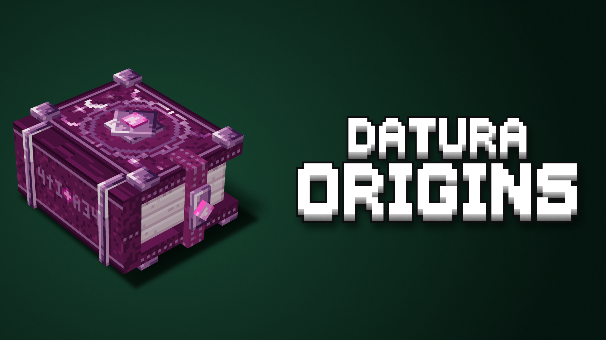
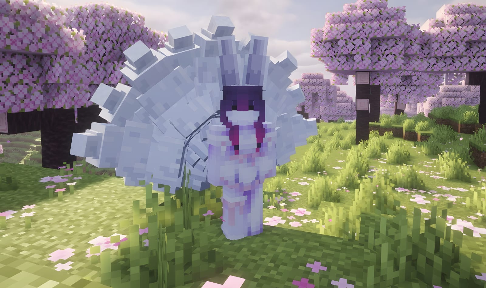
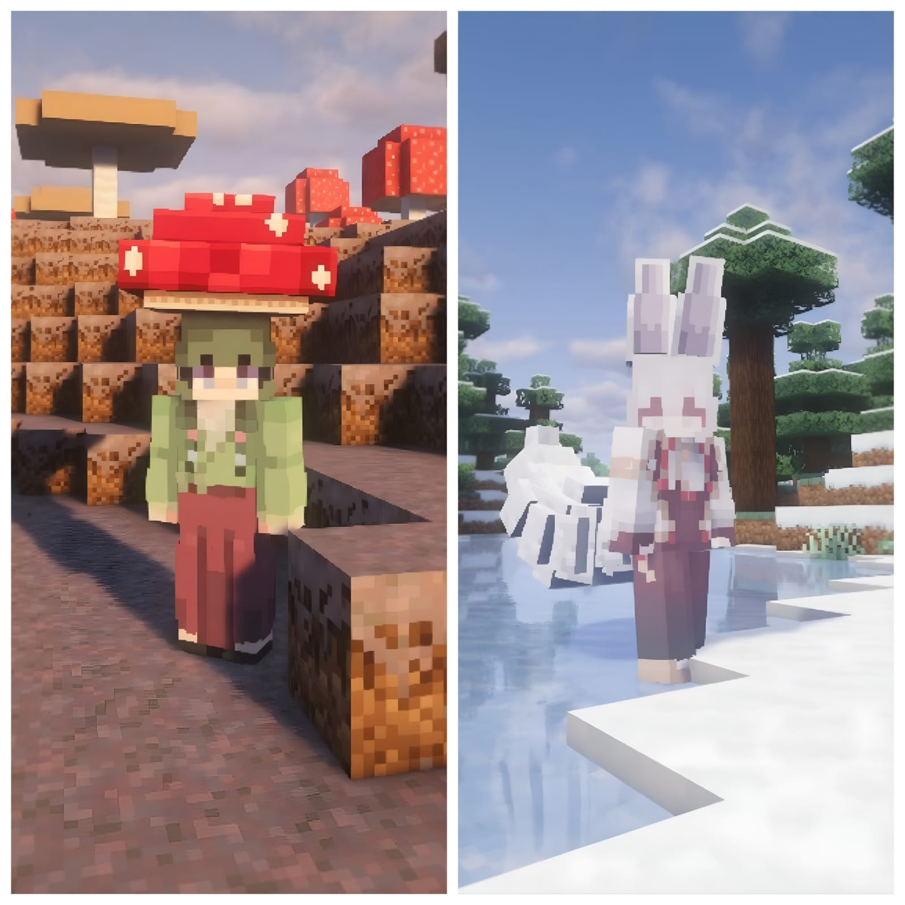
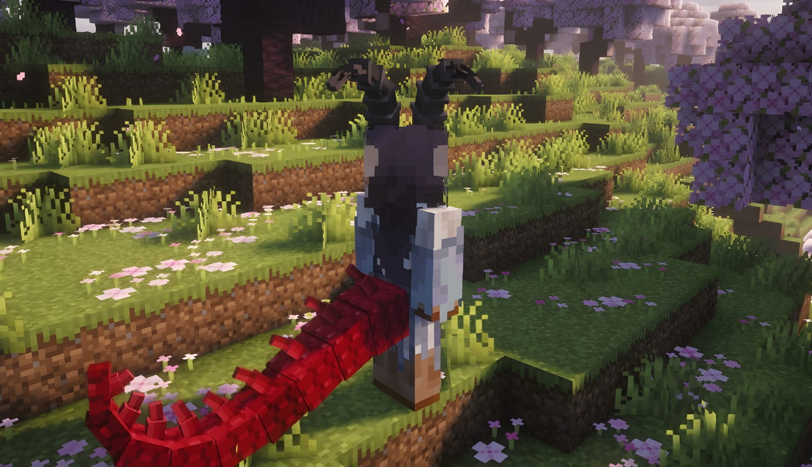
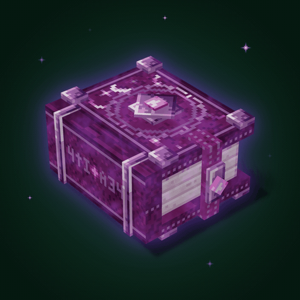
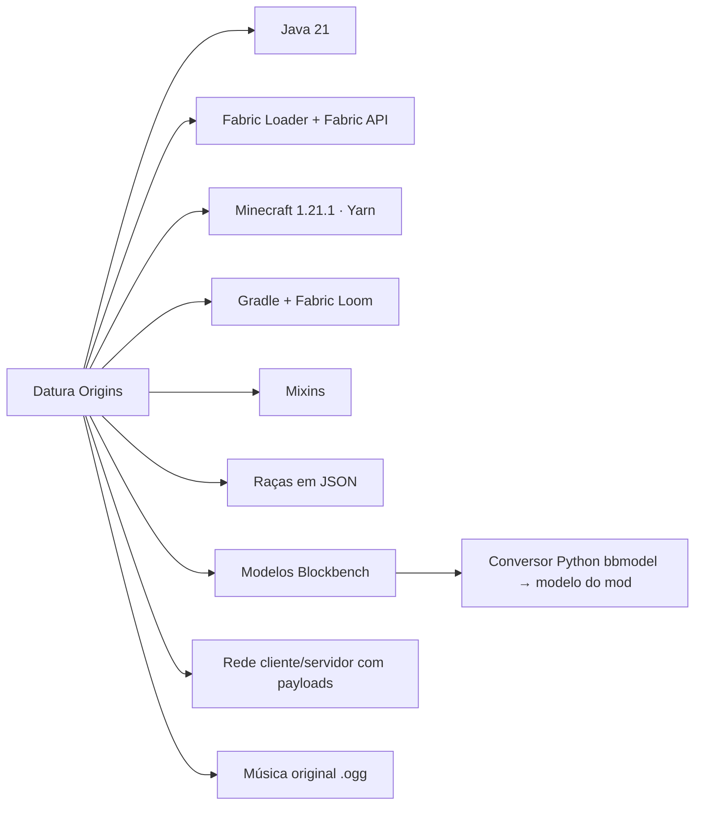

<p align="center"></p>

<p align="center"><b>Datura Origins v1.0.2</b> · Fabric · Minecraft 1.21.1</p>

&nbsp;

## Sobre

Datura Origins é um mod de raças para Minecraft. Ao entrar no mundo, você abre um grimório e escolhe sua origem. Cada raça tem um corpo próprio, vantagens, fraquezas e uma habilidade ativa. Nenhuma raça é perfeita: cada uma tem um ponto forte e uma fraqueza que o grupo ajuda a compensar.

&nbsp;

&nbsp;

<p align="center">
  
</p>

&nbsp;

&nbsp;

## Funcionalidades

- **Multilíngue**: acompanha o idioma do Minecraft (português e inglês incluídos; outros idiomas usam o inglês).
- **Tela de seleção em forma de grimório**, com prévia 3D do personagem já usando a raça, lista de vantagens, desvantagens e habilidade.
- **Música ambiente original** e sons suaves de brilho na tela de seleção, seguindo o volume do jogo.
- **24 raças**, cada uma com sua própria página no grimório.
- **Modelos 3D animados** feitos no Blockbench: caudas, asas, orelhas, chifres e chapéus que reagem a andar, nadar, voar, sentar e atacar.
- **Habilidade ativa** por raça, com recarga.
- **Formas do Nether**: Dríade, Espectro e Morto-Vivo perdem parte dos dons no Nether.
- **Maturidade**: Dragão, Morto-Vivo e Demônio evoluem com o tempo, com barra própria no lugar da barra de experiência.
- **Raças em JSON**: cada raça é um arquivo em `datura_races/`, e addons podem criar raças e tipos de poder novos (veja [docs/api.md](docs/api.md)).

&nbsp;

<p align="center">
  
</p>

&nbsp;

## Controles

| Tecla | Ação |
|---|---|
| `O` | Abre o grimório de raças |
| `Z` | Usa a habilidade da raça |

As teclas podem ser trocadas em *Opções → Controles*.

&nbsp;

## Comandos

| Comando | Descrição |
|---|---|
| `/do race` | Mostra sua raça atual |
| `/do race change` | Abre o grimório para trocar de raça |
| `/do race change <jogador>` | Faz outro jogador escolher de novo (operador) |
| `/do race set <jogador> <raça>` | Define a raça de um jogador (operador) |
| `/do race list` | Lista todas as raças |
| `/do full maturity` | Leva a maturidade ao máximo (cheats) |
| `/do reset cooldown` | Zera a recarga da habilidade (cheats) |
| `/do no cooldown` | Liga/desliga a habilidade sem recarga (cheats) |

&nbsp;

## Raças

| Raça | Resumo | Habilidade |
|---|---|---|
| Elfo | Leve e certeiro com o arco, mas de corpo frágil. | Recuo Ágil |
| Elfo Real | Linhagem real, protegido por uma égide dourada. | Égide Espelhada |
| Elfo Noturno | Assassino silencioso que caça à noite. | Passo Sombrio |
| Elfo da Lua | Delicado de dia, perigoso sob o luar. | Queda da Lua |
| Vampiro | Forte e rápido, vive de sangue e queima no sol. | Mordida Vampírica |
| Dragão | Já nasce com 3 blocos de altura e cresce conforme amadurece. | Bola de Fogo |
| Raposa Mística | Raposa cor de brasa, amiga das raposas; as ilusões queimam. | Ilusões de Raposa |
| Raposa Mística da Neve | Raposa branca como o gelo; as ilusões congelam. | Ilusões de Raposa |
| Dríade | Faz as plantas crescerem, mas o fogo a consome. | Florescer |
| Dama Cogumelo | Variante da Dríade, de chapéu de amanita. | Caldeirão Venenoso |
| Espectro | Alma sem fome que enxerga no escuro. | Forma Espectral |
| Minotauro | Lento e pesado, cada golpe derruba muralhas. | Arremesso de Rocha |
| Fada | Pequena, voa sem parar com asas de mariposa. | Santuário de Flores |
| Sereia (Encantada) | Rápida na água, protege os amigos com o canto. | Canto das Marés |
| Sereia das Profundezas | Cauda de cristal que desperta a magia do mar. | Altar Abissal |
| Sereia Grega | A sereia dos mitos, que só come carne. | Canto das Marés |
| Orc | Guerreiro da horda, bate forte e aguenta muito. | Pisão |
| Bode | Sátiro das montanhas que pula até 5 blocos de altura. | Chifrada |
| Morto-Vivo | Não come nem descansa, comanda os mortos. | Exército dos Mortos |
| Demônio | Os monstros se afastam, e a alma amadurece com o tempo. | — |
| Gárgula | Estátua viva que voa com asas de pedra. | Meteoro |
| Lilac | Gênia da lâmpada viciada em ouro e apostas. | Cassino |
| Kitsune (Celestial) | Raposa de nove caudas brancas que volta da morte. | Orbe Espiritual |
| Kitsune Corrompida | Nove caudas vermelhas, acorrenta as presas. | Prisão de Correntes |

&nbsp;

&nbsp;

<p align="center">
  
</p>

&nbsp;

&nbsp;

---

## Créditos e Inspiração

Este projeto é uma homenagem e uma reinterpretação inspirada no mod original **[Origins](https://github.com/apace100/origins-fabric)**, criado por **apace100**. Todo o mérito pela ideia original de escolha de raças com vantagens, desvantagens e habilidades no Minecraft pertence ao projeto original — o **Datura Origins** foi desenvolvido do zero como uma visão própria e independente dessa mecânica.

&nbsp;

<p align="center">
  
</p>

Feito por Daturaasa.

&nbsp;

## Instalação

1. Instale o [Fabric Loader](https://fabricmc.net/use/) para o Minecraft 1.21.1.
2. Coloque o [Fabric API](https://modrinth.com/mod/fabric-api) e o `Datura-Origins-1.0.2-fabric-1.21.1.jar` na pasta `mods`.
3. Requer Java 21.

&nbsp;

&nbsp;

&nbsp;

## Criando novas raças

> Se você chegou até aqui apenas para jogar e não tem intenção de criar raças, mexer em códigos ou compilar o mod, pode parar a leitura por aqui — o resto é voltado apenas para desenvolvedores e criadores de add-ons!

&nbsp;

O Datura Origins carrega raças de **qualquer mod** instalado. Uma raça é um arquivo JSON com textos, poderes, habilidade e modelos; o grimório lista tudo sozinho. Você pode criar um addon separado (recomendado) ou adicionar arquivos direto neste projeto.

&nbsp;

### Estrutura de arquivos

```
src/main/resources/
├─ fabric.mod.json
├─ datura_races/
│  └─ guerreira.json                       ← a raça
└─ assets/meuaddon/
   ├─ lang/en_us.json, pt_br.json          ← textos
   ├─ models/part/asas_guerreira.json      ← modelo convertido
   └─ textures/entity/part/asas_guerreira.png
```

Neste repositório, as raças do mod ficam em `shared-resources/datura_races/` e os recursos em `shared-resources/assets/datura_origins/`.

&nbsp;

Modele no Blockbench (formato *Generic Model*, em cima do Steve: chão em y=0, pescoço em y=24) e converta:

```
python tools/bbmodel_to_part.py <pasta-resources> minha_parte.bbmodel=asas_guerreira
```

O conversor gera o modelo e a textura. Uma pasta raiz chamada `head` ou `body` define onde a peça prende; grupos terminados em `_glow` brilham no escuro. Opções após `:` — `hide_legs` (esconde as pernas, como nas sereias), `static` (sem física de balanço), `pulse` (brilho pulsando).
Animações com estes nomes tocam sozinhas: `idle`, `walk`, `run` (correndo), `fly`, `glide`, `swim`, `swim_fast`, `swim_idle`, `crawl`, `sit_down`/`sit_idle`, `coil`/`coil_idle` (após 3 s parado) e `balanco` (ao atacar).

&nbsp;

### A raça (JSON)

```json
{
	"id": "guerreira",
	"order": 30,
	"name": "race.meuaddon.guerreira.name",
	"description": "race.meuaddon.guerreira.description",
	"color": "#C25A8C",
	"model": ["asas_guerreira"],
	"advantages": ["race.meuaddon.guerreira.advantage.0"],
	"disadvantages": ["race.meuaddon.guerreira.disadvantage.0"],
	"ability": {
		"type": "datura_origins:fireball",
		"name": "race.meuaddon.guerreira.ability.name",
		"description": "race.meuaddon.guerreira.ability.description",
		"cooldown": 300
	},
	"powers": [
		{ "type": "datura_origins:attribute", "attribute": "minecraft:generic.max_health", "operation": "add_value", "amount": 4 },
		{ "type": "datura_origins:status_effect", "effect": "minecraft:night_vision" }
	]
}
```

- `order` define a posição na lista; empates seguem o nome do arquivo.
- `powers` usa os tipos já existentes (veja os JSONs das raças do mod como exemplo); `ability` é a habilidade da tecla `Z`.
- Variantes: `"variant_of": "<id da raça base>"` coloca a raça logo depois da base.
- Tipos de poder novos: entrypoint `datura_origins:powers` com `PowerRegistry.registerPowerType` / `registerAbilityType` (detalhes em [docs/api.md](docs/api.md)).

&nbsp;

### Textos e traduções

Use chaves de tradução nos campos de texto e crie os arquivos em `assets/<seu-mod>/lang/`. O jogo escolhe o idioma do jogador e cai para `en_us.json` quando não há tradução, então **sempre inclua o inglês**.

```json
{
	"race.meuaddon.guerreira.name": "Warrior",
	"race.meuaddon.guerreira.advantage.0": "Has 2 extra hearts."
}
```

Texto literal também funciona, mas não é traduzido.

&nbsp;

### Registro e numeração

Não é preciso registrar nada no código: na inicialização o mod lê a pasta `datura_races/` de todos os mods e coloca as raças no grimório pela ordem de `order`. Os números romanos são calculados na hora pela posição na lista, então uma raça nova continua a sequência (XXV, XXVI...) sem lacunas e sem mexer nas existentes.
Para registrar pelo código em vez de JSON, implemente `RaceProvider` no entrypoint `datura_origins` (exemplo em [docs/api.md](docs/api.md)).

&nbsp;

## Tecnologias



---

&nbsp;

Feito por Daturaasa. Todos os direitos reservados.
O **Datura Origins** é um projeto independente desenvolvido do zero, sem reutilização de código ou ativos de terceiros, criado como uma homenagem e inspirado pelo mod original **[Origins](https://github.com/apace100/origins-fabric)**!

<p align="center"></p>
